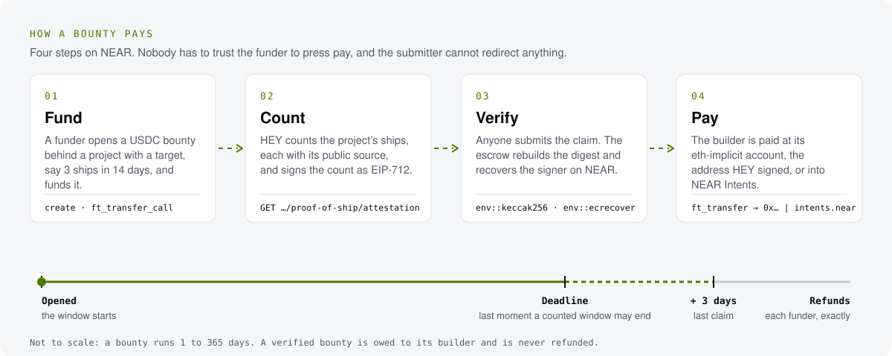
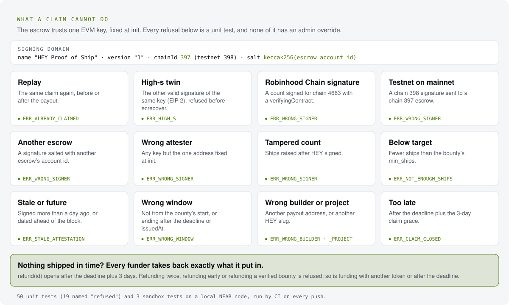

<a href="https://nearblocks.io/address/escrow.heyresearch.near">
  <picture>
    <source media="(prefers-color-scheme: dark)" srcset="assets/hero-dark.svg">
    
  </picture>
</a>

<p align="center">
  <a href="https://github.com/hey-research-lab/proof-of-ship-near/actions/workflows/ci.yml"></a>
  <a href="LICENSE"></a>
  <a href="https://nearblocks.io/address/escrow.heyresearch.near"></a>
  <a href="#hackathon-notes"></a>
  <a href="https://heyresearch.xyz"></a>
</p>

<p align="center">
  A bounty escrow that pays builders for shipping, not for promising. Anyone locks USDC on NEAR behind a project.<br>
  It is released only when <a href="https://heyresearch.xyz">Hey Research Lab</a> (HEY) signs that it counted at least the bounty's target<br>
  number of ships, each with its public source. The escrow checks that signature on chain with <code>env::ecrecover</code>.<br>
  No target by the deadline? Every funder takes back exactly what they put in.
</p>

<p align="center">
  <b>Built at NEAR HACKATHON</b> (1 to 14 November 2026) · Tracks: Agent Economy, Social Money, Real-World Money
</p>

<p align="center">
  <a href="#live-now">Live now</a> ·
  <a href="#do-x-see-y">Do X, see Y</a> ·
  <a href="#how-it-works">How it works</a> ·
  <a href="#security">Security</a> ·
  <a href="#the-attestation-hey-signs">The attestation</a> ·
  <a href="#where-the-money-goes">Where the money goes</a> ·
  <a href="#contract">Contract</a> ·
  <a href="#deploy">Deploy</a>
</p>

## Live now

| | |
| :-- | :-- |
| **Mainnet escrow** | [`escrow.heyresearch.near`](https://nearblocks.io/address/escrow.heyresearch.near), deployed and initialised in [one transaction](https://nearblocks.io/txns/CHGjBYXwTNyakcnsbfn4GLsYyFWsD7dJGUvyhYH6nrHF) on 3 November 2026: USDC on NEAR, chain id 397, HEY's attester `0x2b30…5760`, guardian `heyresearch.near` |
| **A paid claim on testnet** | [the claim transaction](https://testnet.nearblocks.io/txns/7ZsTWDGz8rA7ekdAhdbspTj6ewAPXDKtohbCtQvMs3nq): 100 test USDC to the builder's eth-implicit account `0x99592be0e47b73754ce1c316527bd2dd29c61538` |
| **Testnet escrow** | [`escrow.proof-of-ship-hey.testnet`](https://testnet.nearblocks.io/address/escrow.proof-of-ship-hey.testnet), funded in [`tusdc.proof-of-ship-hey.testnet`](https://testnet.nearblocks.io/address/tusdc.proof-of-ship-hey.testnet) (test USDC with a public faucet) |
| **The same attester on Robinhood Chain** | [`ShipEscrow` 0x3Da1…25f2](https://robinhoodchain.blockscout.com/address/0x3Da17a89F1d29aB96419269514C798a8dd6125f2) trusts the same key, `0x2b30…5760`, and already pays builders in $WIF ([hey-research-lab/proof-of-ship](https://github.com/hey-research-lab/proof-of-ship)) |
| **The page** | [hey-research-lab.github.io/proof-of-ship](https://hey-research-lab.github.io/proof-of-ship/), with the [NEAR option on the page](https://hey-research-lab.github.io/proof-of-ship/) |

The mainnet escrow still holds its full-access key: until the operator deletes it (see [Deploy](#deploy)), trust the
operator as well as the code ([SECURITY.md](SECURITY.md)). The `list-keys` row below shows its state at any time.

## Why

Grants and bounties usually pay for a pitch. Proof of Ship pays for receipts. HEY already reads what projects ship
(releases, contract deployments, code weeks, changelogs), counts it by one public rule, and gives every ship a source
anyone can open. This escrow turns that count into money.

| Who | What they get |
| :-- | :-- |
| **Funders** (a DAO, a community, a protocol's grants budget, an agent) | Lock USDC behind a project with a target, for example "3 ships in 14 days". No need to judge the work themselves, and the money comes back if nothing ships. |
| **Builders** | Paid in USDC to an address HEY already ties to their project (the deployer of their token, or the wallet that signed their claim on HEY). Nobody has to trust the funder to press "pay". |
| **Agents and relayers** | Can submit the claim for a builder. The recipient is fixed inside HEY's signature, so the submitter cannot redirect anything. |

HEY signs a count, not a verdict: the signature says how many ships HEY counted in the window. It does not say the
project is good, safe or worth funding.

## Do X, see Y

You need [rustup](https://rustup.rs) (the toolchain, Rust 1.93.0 with `wasm32-unknown-unknown`, installs itself from
`rust-toolchain.toml`), [cargo-near](https://github.com/near/cargo-near) 0.22.0, Node 18 or newer, and for the testnet
demo and the mainnet reads [near-cli-rs](https://github.com/near/near-cli-rs) 0.30.1:

```sh
curl --proto '=https' --tlsv1.2 -sSf https://sh.rustup.rs | sh -s -- -y --profile minimal
curl --proto '=https' --tlsv1.2 -LsSf https://github.com/near/cargo-near/releases/download/cargo-near-v0.22.0/cargo-near-installer.sh | sh
curl --proto '=https' --tlsv1.2 -LsSf https://github.com/near/near-cli-rs/releases/download/v0.30.1/near-cli-rs-installer.sh | sh
```

**Run the tests**

| Do | See |
| :-- | :-- |
| `./scripts/test.sh` | The whole suite: `test result: ok. 50 passed` (unit tests), three wasm files under `target/near/`, then `test result: ok. 3 passed` (sandbox tests on a local NEAR node, about 70 seconds; the first build takes a few minutes) |
| `cargo test -p ship-escrow domain_and_digest_match_viem` | The escrow's EIP-712 domain separator, digest and signature recovery equal what [viem](https://viem.sh) computes (`contract/src/vectors.json`, regenerated by `node scripts/vectors.mjs`) |
| `cargo test -p ship-escrow refused` | 19 refusal tests pass: replay, high-s, Robinhood Chain domain, testnet domain on mainnet, another escrow's domain, wrong attester, tampered count, below target, expired, stale, future-dated, wrong window, wrong builder, wrong project, and more |
| `cargo test -p integration-tests -- --test-threads=1` | On a sandbox node: a valid claim pays the builder's eth-implicit account `0xb1b1…` 100 USDC; the bad claims are refused on chain; an Intents payout credits `nep141:<token>` to the builder's NEAR Intents account; a refused Intents deposit falls back to a direct payout; after the deadline plus 3 days a claim is refused and both funders refund exactly |

**Try it on testnet**

| Do | See |
| :-- | :-- |
| `./scripts/demo-testnet.sh <you>.testnet` | Against the live testnet escrow, in about a minute: a new account from the faucet if needed, 100 test USDC, a bounty opened and funded, a 2-ship claim refused with `ERR_NOT_ENOUGH_SHIPS`, a 3-ship claim paid, `ft_balance_of(0x…) = "100000000"`, the replay refused with `ERR_ALREADY_CLAIMED`, every transaction linked on nearblocks |
| `near contract call-function as-read-only escrow.proof-of-ship-hey.testnet get_config json-args '{}' network-config testnet now` | The fixed attester, token, chain id 398, salt and domain separator |
| `node scripts/sign.mjs --escrow escrow.proof-of-ship-hey.testnet --chain 398 --slug predict-fwa --builder 0x1111111111111111111111111111111111111111 --since 1 --until 2 --ships 3 --issued-at 2` | An attestation in the shape HEY's API returns, its EIP-712 digest and a signature by the public test key |
| `near contract call-function as-read-only escrow.proof-of-ship-hey.testnet recover_signer json-args "$(node scripts/sign.mjs --escrow escrow.proof-of-ship-hey.testnet --chain 398 --slug predict-fwa --builder 0x1111111111111111111111111111111111111111 --since 1 --until 2 --ships 3 --issued-at 2 --print view-args)" network-config testnet now` | `"is_attester": true` and the same `digest` as the row above: the contract recovers the signer with `env::ecrecover` exactly as a claim does. Add `--chain 397` and see `"is_attester": false`: a mainnet signature does not verify on testnet |

**Read the mainnet escrow**

| Do | See |
| :-- | :-- |
| `near contract call-function as-read-only escrow.heyresearch.near get_config json-args '{}' network-config mainnet now` | `"attester": "0x2b309b352ff49d04912ca34984b27a5481325760"`, `"chain_id": 397`, `"salt": "0xce8386c1…b9bded62"` (`keccak256("escrow.heyresearch.near")`), `"guardian": "heyresearch.near"`, `"intents": "intents.near"`, `"retired": false`, the USDC token `17208628…36133a1` |
| `near account list-keys escrow.heyresearch.near network-config mainnet now` | The account's access keys: one full-access key as of 4 November 2026, none once the operator deletes them |

The testnet escrow trusts a **public test key**, `keccak256("hey-proof-of-ship-near test attester")` (address
`0x77F4b5aC68a7fcB5008ff585b812f4b0231043A9`), so that anyone can sign its attestations and try the flow. A mainnet
escrow trusts only HEY's attester key.

## How it works

<picture>
  <source media="(prefers-color-scheme: dark)" srcset="assets/flow-dark.svg">
  
</picture>

| Step | What happens on NEAR |
| :-- | :-- |
| **1. Open** | Anyone calls `create(builder, slug, min_ships, deadline, payout)` with 0.01 NEAR for storage (the unused part comes back). `builder` is the builder's EVM address, `slug` the project's page on HEY (`heyresearch.xyz/project/<slug>`), `payout` is `near` (default) or `intents`. The bounty's window starts now. |
| **2. Fund** | Anyone sends USDC with `ft_transfer_call` to the escrow, `msg` `{"action":"fund","id":<id>}`. The escrow's `ft_on_transfer` accepts only its own token and only for an open bounty before its deadline; anything else is refused and the token refunds the sender in full (NEP-141). |
| **3. Ship** | The builder ships. HEY counts by the rule it uses on every project page: corroborated building evidence, at most one ship of each kind a day, only ships HEY first recorded inside the window. |
| **4. Claim** | Anyone fetches HEY's signed count and calls `claim(id, attestation, signature)`. The escrow rebuilds the EIP-712 digest with `env::keccak256`, recovers the signer with `env::ecrecover`, and checks every rule below. Then it pays: `storage_balance_of`, `storage_deposit` if the builder's account is not registered with the token yet (paid from the claimer's 0.00125 NEAR, returned if not needed), and `ft_transfer`. |
| **5. Or refund** | Not claimed by the deadline plus 3 days? Each funder calls `refund(id)` and gets back exactly what they put in. |

A claim is refused unless all of these hold (the same rules as the Robinhood Chain `ShipEscrow`):

- the escrow is not retired, the bounty is open and funded, and now is at most the deadline plus 3 days;
- `project == keccak256(slug)` and `builder` equal the bounty's;
- `since` equals the bounty's start, `since <= until <= deadline`, and `until <= issuedAt`;
- `issuedAt` is not in the future and at most one day old;
- `ships >= min_ships`;
- the signature is 65 bytes, `s` is in the lower half of the curve order (high-s is refused, EIP-2), and the
  recovered address is the attester fixed at init.

A bounty can be claimed once. Once HEY's attestation is accepted the bounty is `verified`: the tokens are owed to the
builder and are never refunded. If the payout itself fails (for example NEAR Intents refuses the deposit), the bounty
stays `verified` and anyone can retry with `release(id)`; after a failed Intents deposit, `release(id, direct: true)`
pays the same builder's eth-implicit account instead.

## Security

<picture>
  <source media="(prefers-color-scheme: dark)" srcset="assets/security-dark.svg">
  
</picture>

<details>
<summary><b>Every refusal and the test that proves it</b></summary>

| Attempt | Refused with | Unit test in `contract/src/tests.rs` |
| :-- | :-- | :-- |
| The same claim again | `ERR_ALREADY_CLAIMED` | `replayed_claim_is_refused`, `replay_after_payout_is_refused` |
| The high-s twin of a valid signature (EIP-2) | `ERR_HIGH_S` | `high_s_signature_is_refused`; `high_s_twin_would_recover_the_attester_without_the_check` proves the twin is real |
| A Robinhood Chain signature (chain 4663, `verifyingContract`) | `ERR_WRONG_SIGNER` | `robinhood_chain_domain_is_refused` |
| A testnet signature (398) on a mainnet escrow (397) | `ERR_WRONG_SIGNER` | `testnet_signature_is_refused_on_mainnet` |
| A signature salted for another escrow account | `ERR_WRONG_SIGNER` | `another_escrows_signature_is_refused` |
| A key other than the attester fixed at init | `ERR_WRONG_SIGNER` | `wrong_attester_is_refused` |
| The ship count raised after signing | `ERR_WRONG_SIGNER` | `tampered_count_is_refused` |
| Fewer ships than `min_ships` | `ERR_NOT_ENOUGH_SHIPS` | `below_target_is_refused` |
| An attestation more than a day old, or dated in the future | `ERR_STALE_ATTESTATION` | `attestation_older_than_a_day_is_refused`, `attestation_from_the_future_is_refused` |
| A window not starting at the bounty's start, or ending after the deadline or `issuedAt` | `ERR_WRONG_WINDOW` | `window_must_start_at_the_bounty_start`, `window_must_end_by_the_deadline`, `window_must_end_by_issued_at` |
| Another builder or another project | `ERR_WRONG_BUILDER`, `ERR_WRONG_PROJECT` | `another_builder_is_refused`, `another_project_is_refused` |
| A claim after the deadline plus 3 days | `ERR_CLAIM_CLOSED` | `claim_after_deadline_and_grace_is_refused` (and `claim_inside_grace_is_accepted`) |
| A claim on an unfunded bounty, or on a retired escrow | `ERR_NOTHING_FUNDED`, `ERR_RETIRED` | `unfunded_bounty_cannot_be_claimed`, `retired_escrow_refuses_claims` |
| Funding with another token, after the deadline, or with a bad message | `ERR_WRONG_TOKEN`, `ERR_FUNDING_CLOSED`, `ERR_BAD_MSG` | `funding_with_another_token_is_refused`, `funding_after_the_deadline_is_refused`, `funding_with_a_bad_msg_is_refused` |
| A refund before the deadline plus 3 days, twice, or of a verified bounty | `ERR_REFUND_NOT_OPEN`, `ERR_NOTHING_TO_REFUND`, `ERR_ALREADY_CLAIMED` | `refund_before_deadline_and_grace_is_refused`, `refund_twice_is_refused`, `verified_bounty_is_never_refunded` |
| Retirement by anyone but the guardian | `ERR_NOT_GUARDIAN` | `only_the_guardian_retires` |

And what does pay: `refund_after_deadline_and_grace_returns_each_contribution`, `retirement_stops_claims_and_opens_refunds`,
and on a sandbox node the three tests in `integration-tests/tests/escrow.rs`.

</details>

- **Signing domain:** chain id 397 on mainnet (398 on testnet) and salt `keccak256(escrow account id)`, so a signature
  for the Robinhood Chain escrow, for the other NEAR network or for another escrow account never verifies. On mainnet
  the salt is `keccak256("escrow.heyresearch.near")` = `0xce8386c18d1be8545f3d07ea9df2eacb21e6762d062f29ed8ab19224b9bded62`.
- **Tests:** 50 unit tests (19 of them named `refused`) and 3 sandbox tests, run by [CI](.github/workflows/ci.yml) on
  every push (actions pinned by commit SHA).
- **Trust and reporting:** what the escrow trusts, and how to report a vulnerability privately, is in
  [SECURITY.md](SECURITY.md).

## The attestation HEY signs

EIP-712, with a domain bound to NEAR and to one escrow account:

```
EIP712Domain(string name,string version,uint256 chainId,bytes32 salt)
  name    = "HEY Proof of Ship"
  version = "1"
  chainId = 397 (NEAR mainnet) or 398 (NEAR testnet)
  salt    = keccak256(utf8 bytes of the escrow's NEAR account id)

Ships(bytes32 project,address builder,uint64 since,uint64 until,uint32 ships,bytes32 evidence,uint64 issuedAt)
```

NEAR has no EVM contract address for `verifyingContract`, so the salt binds a signature to one escrow account. The
`Ships` struct is byte for byte the one the Robinhood Chain escrow verifies; a Robinhood Chain signature (chain 4663,
`verifyingContract`) never verifies here, and the tests prove it.

`claim` takes the attestation exactly as `GET https://heyresearch.xyz/api/v1/proof-of-ship/attestation` returns it
under `attestation` (seconds may be JSON numbers or decimal strings; hex in either case):

```json
{
  "id": 0,
  "attestation": {
    "project": "0x9e806d6ac1bfb6b5f2adec1970138f021d8603335b0e94c3687f50b8e0786f2e",
    "builder": "0x99592BE0E47B73754cE1c316527bd2Dd29C61538",
    "since": 1793713634,
    "until": 1793713645,
    "ships": 3,
    "evidence": "0xd28b44fdf67f48a722d7f8a41d415dfecd3c4eb182c7fdc937b1cb2a104c1729",
    "issuedAt": 1793713645
  },
  "signature": "0x<r 32 bytes><s 32 bytes><v 1 byte, 27 or 28>"
}
```

`project` is `keccak256` of the HEY slug, `evidence` is `keccak256` of the sorted ship ids (`ship:<uuid>`) joined by
commas, each of which opens on HEY with its source.

## Where the money goes

The builder in HEY's signature is an EVM address. The escrow pays it on NEAR in one of two ways, both real on NEAR
mainnet today.

**1. `near` (the default): the builder's eth-implicit account.** NEAR account ids include Ethereum-like accounts, `0x`
plus 40 lower-case hex characters ([NEAR docs: account ids](https://docs.near.org/protocol/accounts-contracts/account-id),
[NEP-518](https://github.com/near/NEPs/blob/master/neps/nep-0518.md)), which an Ethereum wallet such as MetaMask
controls. The escrow registers that account with the token if needed (`storage_deposit`, NEP-145,
[NEAR docs: fungible tokens](https://docs.near.org/integrations/fungible-tokens)) and sends `ft_transfer`. The account
does not have to exist yet: the balance lives in the token contract, and the builder spends it from a NEAR app that
signs in with an Ethereum wallet.

**2. `intents`: the builder's NEAR Intents account.** The escrow calls `ft_transfer_call` on the token with
`receiver_id` `intents.near` and `msg` set to the builder's `0x…` account
([NEAR Intents docs: deposits](https://docs.near-intents.org/integration/verifier-contract/deposits-and-withdrawals/deposits)).
NEAR Intents derives exactly that account id for a secp256k1 key and lets it sign intents with ERC-191, so MetaMask
alone controls it ([account abstraction](https://docs.near-intents.org/integration/verifier-contract/account-abstraction),
[signing](https://docs.near-intents.org/integration/verifier-contract/signing-intents)). From there the builder
withdraws or swaps to any chain Intents supports, for example USDC on Base or Ethereum.

<details>
<summary><b>What is not contract-callable, and so not in v1</b></summary>

The escrow cannot itself route a payout to another chain. A withdrawal out of NEAR Intents to Base, Ethereum or Solana
is either a swap that needs a solver quote (the
[1Click API](https://docs.near-intents.org/integration/distribution-channels/1click-api/quickstart/signed-intent-execution)
answers it off chain, and with `depositType: INTENTS` the user's own signature authorizes it) or an intent signed by
the account owner. The escrow holds neither the quote nor the builder's key. So v1 pays on NEAR, to an account only the
builder's EVM key controls, and the builder (or an agent the builder signs for) takes it cross-chain from there.

</details>

## NEAR technology used

| | Where |
| :-- | :-- |
| `env::ecrecover`, `env::keccak256` | `contract/src/eip712.rs`: the EIP-712 digest and the secp256k1 recovery of HEY's signature, with the host's malleability check on and an explicit high-s refusal |
| NEP-141 fungible tokens | funding through `ft_transfer_call` / `ft_on_transfer`, payouts and refunds through `ft_transfer`, USDC on NEAR (`17208628f84f5d6ad33f0da3bbbeb27ffcb398eac501a31bd6ad2011e36133a1`) |
| NEP-145 storage management | the builder's token registration at payout (`storage_balance_of`, `storage_deposit`) |
| Eth-implicit accounts | the payout recipient `0x…` derived from the address HEY signs |
| NEAR Intents | the optional `intents` payout: a deposit into `intents.near` for the builder's `0x…` account |
| NEP-297 events | `bounty_created`, `funded`, `claim_verified`, `payout_sent`, `claimed`, `payout_incomplete`, `refunded`, `refund_failed`, `escrow_retired` |
| near-workspaces | the sandbox tests, with a local NEAR node whose clock is fast-forwarded past the deadline plus the grace |
| cargo-near, near-cli-rs | the wasm build, and deploying and calling the contracts |

## Contract

`contract/src/lib.rs`, one contract, no owner and no admin method.

<details>
<summary><b>Every method, who may call it and what it does</b></summary>

| Method | Who | What |
| :-- | :-- | :-- |
| `new(attester, token, chain_id, guardian?, intents?, token_storage_deposit?)` | the escrow account, once, in the deploy transaction | fixes HEY's EVM attester, the one NEP-141 token, chain id 397 or 398, an optional guardian and the NEAR Intents verifier |
| `create(builder, slug, min_ships, deadline, payout?)` | anyone, with storage NEAR | opens a bounty; `slug` must be a HEY slug (`^[a-z0-9][a-z0-9-]{0,127}$`); the deadline 1 to 365 days away |
| `ft_on_transfer` with `{"action":"fund","id":N}` | the token, for anyone | adds to an open bounty before its deadline |
| `claim(id, attestation, signature)` | anyone, with 0.00125 NEAR and 100 TGas (130 for `intents`) | verifies HEY's signature and pays the builder |
| `release(id, direct?)` | anyone | retries the payout of a verified bounty |
| `refund(id)` | each funder | returns their own contribution after the deadline plus 3 days, or at once after retirement |
| `retire()` | the guardian, with 1 yoctoNEAR | stops claims for good and opens refunds at once; can move no token anywhere |
| `get_config`, `bounty_count`, `get_bounty`, `get_bounties`, `get_contribution`, `digest`, `recover_signer` | views | read everything, including the digest HEY signs and who signed an attestation |

</details>

Compared with the Robinhood Chain `ShipEscrow`:

- **The same:** the signed struct, the window rules, the one-day attestation age and the 3-day claim grace.
- **No burn share:** a USDC bounty pays in full.
- **Opening and funding are two transactions:** a NEP-141 transfer cannot carry the NEAR a new bounty's storage needs.
- **The slug must be a HEY slug:** HEY signs no other shape.
- **A failed payout stays owed:** a verified bounty whose payout failed can be released again, because a NEAR payout is
  a cross-contract call that can fail after the signature was accepted.

## Deploy

Testnet:

```sh
NETWORK=testnet ESCROW=escrow.<you>.testnet ATTESTER=0x77F4b5aC68a7fcB5008ff585b812f4b0231043A9 \
  TOKEN=<nep141> SIGN=sign-with-legacy-keychain ./scripts/deploy.sh
```

Mainnet is deployed by HEY's operator from HEY's own NEAR account, never from CI and never by this repository's tooling
without an explicit `CONFIRM_MAINNET=yes`:

```sh
NETWORK=mainnet ESCROW=<escrow account>.near ATTESTER=<HEY attester address> GUARDIAN=<cold account>.near \
  CONFIRM_MAINNET=yes ./scripts/deploy.sh
```

On mainnet the token defaults to USDC on NEAR and the Intents verifier to `intents.near`. Deploy and init are one
transaction (init is private to the escrow account). After checking `get_config`, the operator registers the escrow
with USDC (`storage_deposit`, 0.00125 NEAR), leaves a few NEAR on the account for storage, and deletes the account's
full-access keys (`near account delete-keys`) so that nobody, HEY included, can redeploy the code that holds the USDC.

## Hackathon notes

- **New in the hackathon window (Q-001, Q-002):** this whole repository, written from 3 November 2026. It ports the
  Robinhood Chain Proof of Ship (an existing HEY product on another chain,
  [hey-research-lab/proof-of-ship](https://github.com/hey-research-lab/proof-of-ship)) to NEAR; no code is shared,
  since that one is Solidity.
- **Libraries (Q-005):** near-sdk and near-contract-standards 5.29.1, near-workspaces 0.23.0 and near-sandbox 0.3.16,
  k256 0.13 and sha3 0.10 (signing in tests), hex, tokio, serde_json and anyhow, viem 2.21.54 (signing scripts and
  test vectors). AI coding assistants helped write it.
- **Tests:** 50 unit tests and 3 sandbox tests, run by [CI](.github/workflows/ci.yml) on every push (actions pinned by
  commit SHA).
- **Pictures:** the SVGs in `assets/` are drawn by `node scripts/visuals.mjs`, with no dependency.

<p align="center"><sub>By <a href="https://heyresearch.xyz">Hey Research Lab</a> · <a href="SECURITY.md">Security</a> · <a href="LICENSE">MIT</a> · Not financial advice</sub></p>
